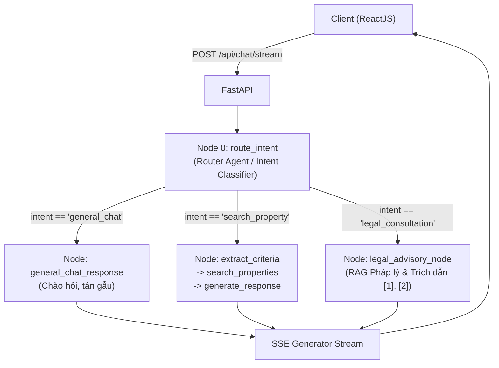

# Đặc Tả Thiết Kế: Phân Hệ Agent Tư Vấn Pháp Lý Nhà Ở & Quản Lý Tài Liệu (Legal Advisory RAG Subsystem)

- **Ngày tạo**: 2026-10-29
- **Trạng thái**: Đã phê duyệt (Approved)
- **Mục tiêu**: Bổ sung một node Agent chuyên biệt trong LangGraph để tư vấn pháp lý nhà ở và đất đai tại Đà Nẵng, có khả năng nạp tài liệu (PDF, Word, Markdown), convert sang Markdown, cắt chunk theo Điều/Khoản luật, lưu trữ vector vào Qdrant và sinh câu trả lời có trích dẫn trực quan (`[1]`, `[2]`) kèm bảng điều khiển Admin quản lý tài liệu.

---

## 1. Tổng Quan Kiến Trúc

Hệ thống bổ sung một nhánh xử lý độc lập cho ý định tư vấn pháp lý (`legal_consultation`), hoạt động song song với nhánh tìm kiếm BĐS (`search_property`) và hội thoại chung (`general_chat`).



---

## 2. Pipeline Xử Lý & Nạp Tài Liệu (Ingestion Pipeline)

### 2.1. Chuyển đổi Đa định dạng sang Markdown
- **Tập tin hỗ trợ**: `.pdf`, `.docx`, `.md`.
- **Thư viện**: `pypdf`, `python-docx`, `python-multipart`.
- **Quy trình chuyển đổi**:
  - Với PDF: Trích xuất các dòng tiêu đề to/in đậm thành `#` (Tên luật), `##` (Chương), `###` (Điều), các khoản đoạn giữ nguyên bullet hoặc số thứ tự.
  - Với DOCX: Đọc các Heading styles (Heading 1, 2, 3) tương ứng `#`, `##`, `###`.
  - Với Markdown: Đọc trực tiếp nội dung văn bản.
- **Lưu trữ tài liệu gốc & bản convert**:
  - Bản thảo Markdown lưu tại `backend/data/legal_docs/{doc_id}.md`.
  - Metadata tài liệu lưu tại `backend/data/legal_docs/documents_meta.json`.

### 2.2. Chiến lược Chunking & Qdrant Collection
- **Cắt đoạn theo cấu trúc luật**: Sử dụng `MarkdownHeaderTextSplitter` chia theo:
  - Header 1 (`#`): Tên văn bản (ví dụ: *Luật Nhà ở số 27/2023/QH15*).
  - Header 2 (`##`): Chương / Mục.
  - Header 3 (`###`): Tên Điều luật cụ thể.
- **Metadata của từng vector chunk**:
  ```json
  {
    "doc_id": "luat_nha_o_2023",
    "doc_title": "Luật Nhà ở số 27/2023/QH15",
    "chapter": "Chương III: Phát triển nhà ở thương mại",
    "article": "Điều 19: Điều kiện của nhà ở tham gia giao dịch",
    "content": "### Điều 19: Điều kiện của nhà ở tham gia giao dịch\n1. Có Giấy chứng nhận quyền sở hữu..."
  }
  ```
- **Qdrant Collection**:
  - Tên collection: `danang_legal_docs`
  - Kích thước vector: `1536` (`text-embedding-3-small`)
  - Khoảng cách: `Cosine`
  - Độc lập hoàn toàn với `danang_properties`.

---

## 3. Thiết Kế LangGraph Agent

### 3.1. Cập nhật Router Classifier
- Mở rộng schema `IntentClassification`:
  ```python
  class IntentClassification(BaseModel):
      intent: Literal["general_chat", "search_property", "legal_consultation"] = Field(...)
      reason: Optional[str] = Field(...)
  ```
  - `legal_consultation`: Hỏi về sổ đỏ, sổ hồng, sang tên đổi chủ, hợp đồng đặt cọc, tranh chấp, điều kiện pháp lý, người nước ngoài mua nhà, thuế phí chuyển nhượng BĐS tại Việt Nam / Đà Nẵng.

### 3.2. Cập nhật State
```python
class AgentState(TypedDict):
    messages: Annotated[Sequence[BaseMessage], add_messages]
    intent: Optional[str]
    criteria: Optional[Dict[str, Any]]
    found_properties: List[Dict[str, Any]]
    citations: Optional[List[Dict[str, Any]]]
```

### 3.3. Node Tư Vấn Pháp Lý (`legal_advisory_node`)
1. Lấy câu hỏi gần nhất của người dùng kết hợp ngữ cảnh hội thoại.
2. Semantic Search trên collection `danang_legal_docs` lấy Top 3 - 5 chunks điểm cao nhất.
3. Nếu không tìm thấy văn bản phù hợp: phản hồi lịch sự hướng dẫn người dùng liên hệ cơ quan đăng ký đất đai / văn phòng công chứng Đà Nẵng.
4. Nếu tìm thấy:
   - Xây dựng Prompt đưa các trích đoạn văn bản được đánh số `[1]`, `[2]`.
   - Yêu cầu LLM: Luôn viện dẫn rõ ràng nguồn luật bằng ký hiệu `[1]`, `[2]` sau từng ý kiến pháp lý.
   - Trả về tin nhắn `AIMessage` và gán danh sách `citations` vào State.

---

## 4. API Endpoints & Giao Thức SSE Stream

### 4.1. Endpoints Quản Trị Tài Liệu (Admin)
- `POST /api/legal/upload`: Tải file (.pdf, .docx, .md) -> tự động chuyển đổi sang Markdown.
- `GET /api/legal/documents`: Lấy danh sách tài liệu, dung lượng, trạng thái index.
- `GET /api/legal/documents/{id}/preview`: Xem nội dung Markdown của tài liệu.
- `POST /api/legal/documents/{id}/index`: Cắt chunk và nạp vector vào Qdrant.
- `DELETE /api/legal/documents/{id}`: Xóa tài liệu khỏi hệ thống và xoá vector points trong Qdrant.

### 4.2. SSE Stream Events (`/api/chat/stream`)
- **Event `citations`**:
  ```json
  data: {"type": "citations", "data": [
    {
      "index": 1,
      "doc_title": "Luật Nhà ở 2023",
      "article": "Điều 19",
      "chapter": "Chương III",
      "content": "Nội dung quy định chi tiết...",
      "score": 0.88
    }
  ]}
  ```
- **Event `token`**: Stream từng cụm từ phản hồi của Bot.
- **Event `[DONE]`**: Kết thúc phiên trả lời.

---

## 5. Thiết Kế Giao Diện Người Dùng (Frontend)

1. **Giao diện Chat (Drawer Trích Dẫn)**:
   - Các số `[1]`, `[2]` trong tin nhắn được render thành các badge màu xanh nổi bật.
   - Click vào badge hoặc nút *"Xem căn cứ pháp lý"* sẽ trượt mở Right-side Drawer hiển thị chi tiết tên luật, điều luật, điểm tương đồng và toàn văn đoạn trích gốc.
2. **Giao diện Admin Portal**:
   - Tab chuyển đổi: **Tư Vấn Khách Hàng** vs **Quản Trị Tài Liệu**.
   - Kéo & thả tài liệu (PDF, Word, MD).
   - Modal xem trước Markdown đã convert.
   - Nút Ingest vào Vector DB và Nút Xoá tài liệu.
